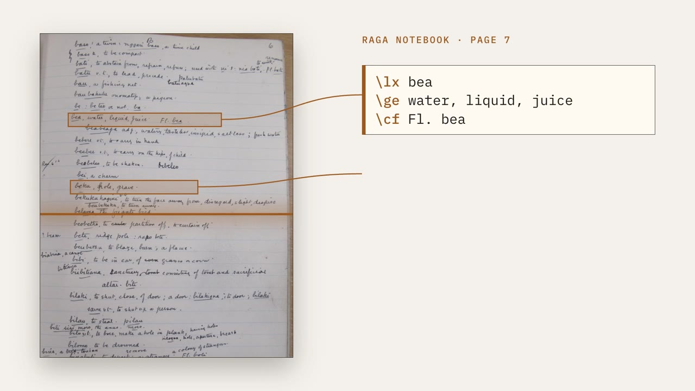
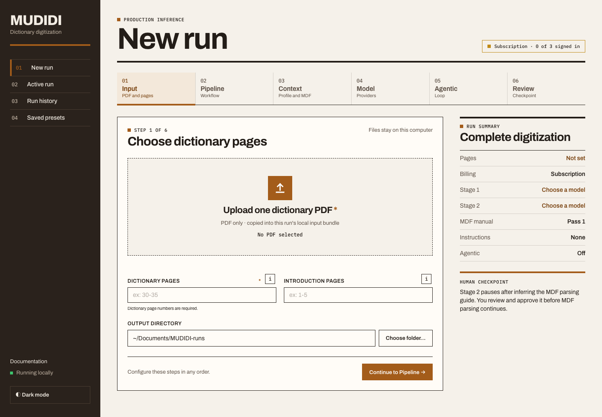

# MUDIDI

MUDIDI digitizes scanned multilingual dictionaries with language models. It
creates a faithful page transcription, discovers the dictionary's structure,
and converts the transcription into
[SIL Toolbox MDF](https://software.sil.org/toolbox/) lexicon records.

**[Documentation](https://naarm-nlp.github.io/mudidi/)** ·
**[Quickstart](https://naarm-nlp.github.io/mudidi/getting-started/quickstart/)**

```text
dictionary PDF or page images
  → Stage 1 transcription
  → MDF parsing-guide discovery and review
  → Stage 2 per-page MDF + combined dictionary
```

## Demo

[](https://naarm-nlp.github.io/mudidi/#demo)

**[Watch the 90-second demo](https://naarm-nlp.github.io/mudidi/#demo)** —
from uploading a scanned dictionary to configuring the digitization pipeline.

## Installation

MUDIDI supports Linux, macOS, and Windows. Docker is recommended for the web
dashboard. Native installation with [uv](https://docs.astral.sh/uv/) is
recommended for CLI and YAML workflows; it requires Python 3.11+, with native
Windows usage supported through WSL2.

### Web dashboard with Docker (recommended)

Docker runs MUDIDI in the same reproducible Linux environment on macOS,
Windows, and Linux. Install [Docker Desktop](https://docs.docker.com/desktop/)
on macOS or Windows, or Docker Engine with the Compose plugin on Linux.

Before running MUDIDI, make sure Docker is running: start Docker Desktop on
macOS or Windows, or start the Docker daemon on Linux, and wait until the
Docker engine is ready. You can verify it with `docker info`.

Then clone the repository, open a terminal in it, and run:

```bash
docker compose up --build
```

Open <http://localhost:8000> in a browser. Stop the app with `Ctrl+C`, or run
`docker compose down` from another terminal. Dashboard settings, encrypted API
credentials, presets, uploaded files, and generated outputs persist in the
local `mudidi-data/` directory. This directory is excluded from Git; keep it
private and back it up as one unit.



The Compose configuration publishes MUDIDI only on `127.0.0.1`, so other
computers on the network cannot connect to it. Do not change this binding to a
public interface: the local dashboard is not designed as a multi-user or
internet-facing service.

See the
**[local web application guide](https://naarm-nlp.github.io/mudidi/production/local-web-app/)**
for startup, shutdown, logs, persistence, and troubleshooting.

### Create a dashboard run

**New run** is a six-step wizard: **Input**, **Pipeline**, **Context**,
**Model**, **Agentic**, and **Review**. The steps can be completed in any
order, and the **Run summary** beside the form tracks the current choices. The
final step validates the whole form on the server and shows a review page
before anything runs.

The web dashboard accepts exactly one dictionary PDF. Both the PDF and **PDF
dictionary pages** are required before a run can be reviewed. Page selections
are 1-based and may be a single page (`5`), a range (`10-20`), comma-separated
pages (`1,5,9`), or a combination (`1,5,10-20`). Every selected page must exist
in the uploaded PDF.

The introduction-page and representative MDF parsing-guide page fields are
optional and use the same syntax. Examples shown in the fields, such as
`ex: 30-35 or 30, 32, 35 or 30, 33-35`, are placeholders rather than prefilled values. If a required value
is missing or a page selection is invalid, the dashboard blocks the run and
marks the affected field in red with an explanation.

In **Context**, choose **Create a guide for me** or supply an existing MDF
parsing guide. When **Pages to learn from** is blank, discovery uses every
selected dictionary page—not every page in the uploaded PDF. For a long
dictionary, choose two or three representative pages to limit the size and cost
of this single discovery request. Generated guides pause the run for review and
approval before MDF conversion.

Page-image and directory inputs remain available through the CLI and YAML
workflows; they are not accepted by the web dashboard.

Once a run starts, every run page shares one tab bar: **Overview**, **MDF
parsing guide**, **Page Viewer & Editor**, **Live Logs**, **File Artifacts**,
and **Usage**.

### Web dashboard with uv

For a native Python installation instead of Docker, install the web extra and
start the dashboard:

```bash
uv sync --frozen --extra web
uv run mudidi web
```

Request and upload sizes are unlimited by default. To cap them, pass
`--max-upload-bytes` for the cumulative managed uploads of one run and/or
`--max-request-bytes` for the complete HTTP request, including multipart
framing. When both are set, the request limit must be the greater of the two.

For example, cap uploads at 100 MiB with a 110 MiB request limit:

```bash
uv run mudidi web \
  --max-request-bytes 115343360 \
  --max-upload-bytes 104857600
```

MUDIDI opens <http://localhost:8000>. Use `--no-browser` to prevent it from
opening a browser automatically, or `--port 8080` to choose another local port.
A native install also adds **Choose folder…** beside the output directory,
which opens the operating system's folder dialog; in Docker, type the path.

### CLI and YAML workflows with uv (recommended)

#### Install uv on macOS or Linux

Use the official standalone installer:

```bash
curl -LsSf https://astral.sh/uv/install.sh | sh
```

Restart the terminal if requested by the installer, then verify the command is
available:

```bash
uv --version
```

#### Install uv on Windows through WSL2

MUDIDI does not currently support native Windows PowerShell. First install
WSL2 with Ubuntu from an Administrator PowerShell terminal:

```powershell
wsl --install -d Ubuntu
```

Restart Windows if requested, open the Ubuntu application, and install uv from
the WSL terminal:

```bash
sudo apt update
sudo apt install -y curl git
curl -LsSf https://astral.sh/uv/install.sh | sh
```

#### Install MUDIDI

Clone the repository and reproduce its locked Python environment:

```bash
git clone https://github.com/naarm-nlp/mudidi.git MUDIDI
cd MUDIDI
uv sync --frozen
```


## Authentication

Choose **Subscription billing** or **API-key billing** in the dashboard's
**Model** step. These are separate authentication modes; a subscription login
does not require a provider API key.

### Subscription accounts

Select OpenAI, Google, or Claude, click **Log in**, and complete the provider's
browser flow. Use **Refresh models** to reload the authenticated account's
catalog. Subscription credentials stay in MUDIDI's encrypted local store, not
in YAML run configuration.

For CLI workflows, authenticate before selecting subscription mode:

```bash
uv run mudidi auth login openai
uv run mudidi auth status openai
uv run mudidi run \
  --auth-mode subscription \
  --auth-provider openai \
  --pages path/to/dictionary-pages \
  --output-dir outputs/my-dictionary
```

Use `google` or `claude` instead of `openai` for the other subscription
providers. Subscription adapters use provider-specific consumer interfaces;
review provider terms before relying on them in production.

### API keys

For the web dashboard, enter the selected provider's key under
**API credentials** in **Model**: Gemini, OpenAI, Anthropic, or OpenRouter.
Click **Save key** beside the credential you entered. Inputs are masked and can
be revealed explicitly with the eye button. Keys persist across restarts as
encrypted ciphertext in `mudidi-web.sqlite3`; the encryption key is stored
separately as `.credential-key` in the dashboard data directory. Keep the whole
data directory private and backed up together.

LiteLLM does not require its own API key when MUDIDI uses it directly. It uses
the key belonging to the provider selected by the model identifier. A LiteLLM
virtual key is needed only when connecting to a separately hosted LiteLLM Proxy.

CLI and YAML workflows continue to read provider keys from `.env` or the
process environment. Copy the example file and add the key used by your model:

```bash
cp .env.example .env
```

```text
GEMINI_API_KEY=replace-me
# OPENAI_API_KEY=replace-me
# ANTHROPIC_API_KEY=replace-me
# OPEN_ROUTER_API_KEY=replace-me
```

Never place credentials in YAML run configuration.

### Google subscription details

Google subscription runs use Antigravity's browser OAuth and Cloud Code Assist
transport directly. In the dashboard, choose **Subscription billing**, select
Google, then click **Log in** and complete the Google consent flow
in the opened browser window. Use **Log out** to remove the stored Antigravity
session.

MUDIDI bundles Google Antigravity's installed-app registration, including the
five Antigravity scopes, so no OAuth environment variables are required for
normal use. A deployment with its own compatible Antigravity registration may
set these optional overrides before starting MUDIDI:

```text
MUDIDI_GOOGLE_OAUTH_CLIENT_ID=your-client-id.apps.googleusercontent.com
MUDIDI_GOOGLE_OAUTH_CLIENT_SECRET=your-client-secret
# GOOGLE_CLOUD_PROJECT=your-project-id
```

Keep override values in `.env` or the process environment, never in YAML run
configurations. Subscription workers do not inherit an override client secret
from the parent environment.

MUDIDI stores the resulting access and refresh tokens only in its encrypted
local subscription store. It does not read OMP, Antigravity CLI, gcloud, or
browser credential stores. The available Gemini model list comes from the
authenticated Cloud Code Assist account. Google subscription mode does not
fall back to `GEMINI_API_KEY` or the public Gemini API catalog.

## Quick end-to-end inference

Process a directory containing page images or individual page PDFs:

```bash
uv run mudidi run \
  --pages path/to/dictionary-pages \
  --output-dir outputs/my-dictionary
```

To select pages from one PDF instead:

```bash
uv run mudidi run \
  --pages path/to/dictionary.pdf \
  --dict-pages "1,5,10-20" \
  --output-dir outputs/my-dictionary
```

Use `--stage 1` for transcription only. See the
[production guide](https://naarm-nlp.github.io/mudidi/production/) for Stage 2
workflows using existing transcriptions.

Inspect the selected defaults without making API calls:

```bash
uv run mudidi run \
  --pages path/to/dictionary-pages \
  --output-dir outputs/my-dictionary \
  --dry-run
```

Enable the bounded Evaluator-Editor loop directly when needed:

```bash
uv run mudidi run \
  --pages path/to/dictionary-pages \
  --output-dir outputs/my-dictionary \
  --stage1-agentic \
  --stage2-agentic
```

The loop is off by default because it adds model calls and cost. When enabled,
the Evaluator proposes changes and the Editor checks them against the source.
Use `--agentic-max-iterations` to override the default of three rounds.

Outputs are written under:

```text
outputs/my-dictionary/
├── resolved_config.json
├── mdf_parsing_guide.json
├── dictionary.mdf.txt
├── dictionary.mdf.report.json
├── stage-1/page_N/page_N_stage1_flat.txt
└── stage-2/page_N/page_N.mdf.txt
```

Each `page_N.mdf.txt` holds exactly the lines printed on that page, so an entry
that crosses a page break is split between two page files.
`dictionary.mdf.txt` joins the pages in order into the complete dictionary.
The report identifies pages that start mid-entry and pages with no MDF; pages
without MDF are excluded from the combined dictionary.

For repeatable and advanced runs, copy a YAML template:

```bash
cp examples/configs/production/directory-inference.yaml mudidi.yaml
```

Edit `input.pages`, the optional `input.alphabet`, `input.dictionary_profile`,
and `output.directory` for your dictionary before validating. Paths are
relative to the YAML file; the template's dataset paths are examples, not
bundled inputs. Then run:

```bash
uv run mudidi config validate mudidi.yaml
uv run mudidi run --config mudidi.yaml
```

For every available option, see the
**[CLI flag reference](https://naarm-nlp.github.io/mudidi/reference/cli/)**
and the
**[complete YAML field reference](https://naarm-nlp.github.io/mudidi/reference/config/)**.

## Documentation

The public documentation is available at
**[naarm-nlp.github.io/mudidi](https://naarm-nlp.github.io/mudidi/)** and
separates two primary workflows:

- **Production Inference** — digitize your own PDF or page directory.
- **Benchmarking & Evaluation** — reproduce experiments against the MUDIDI dataset.

The site is rebuilt and deployed automatically from `main` with GitHub Pages.
Documentation sources are under [`docs/`](docs/), and canonical configurations
are under [`examples/configs/`](examples/configs/). Tracked benchmark report
provenance is documented in [`evaluations/README.md`](evaluations/README.md).

Version **[0.2.0](https://github.com/naarm-nlp/mudidi/releases/tag/v0.2.0)**:
see the [release notes](docs/whats-new.md) for changes and upgrade guidance.

## Dataset and paper

The benchmark contains 30 public-domain multilingual dictionaries. The gold-annotation dataset is available on [Hugging Face](https://huggingface.co/datasets/Davidsamuel101/MUDIDI), and the model outputs are available on [Zenodo](https://zenodo.org/records/22119491).

```bibtex
@misc{mudidi2026,
  title         = {{MUDIDI: A Two-Stage Framework for Multilingual Dictionary Digitization with Language Models}},
  author        = {Setiawan, David and Khishigsuren, Temuulen and Agarwal, Milind and Pit, Pagnarith and Mahmudi, Aso and Vylomova, Ekaterina},
  year          = {2026},
  eprint        = {2606.09435},
  archivePrefix = {arXiv},
  primaryClass  = {cs.CL},
  doi           = {10.48550/arXiv.2606.09435},
  url           = {https://arxiv.org/abs/2606.09435}
}
```
